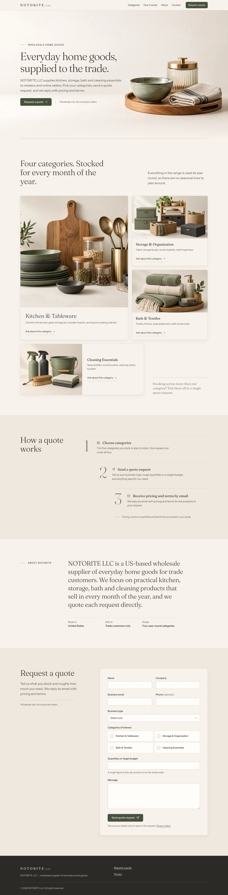
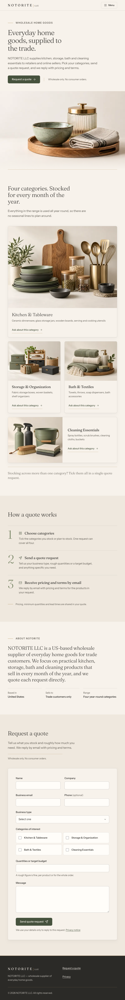
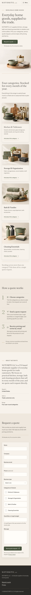

# NOTORITE site: build report

Screenshots are in [`docs/screenshots/`](screenshots/), taken with Playwright using system Chrome. Lighthouse 13 was run against the local server.

| | Performance | Accessibility | Best Practices | SEO |
|---|---|---|---|---|
| Mobile | 100 | 100 | 100 | 100 |
| Desktop | 100 | 100 | 100 | 100 |

Mobile first load: LCP 1.7 s, CLS 0.01, TBT 0 ms, **341 KiB total** (budget ~1 MB). No horizontal scroll at 390, 768 or 1440. No console errors.

| 1440 | 768 | 390 |
|---|---|---|
|  |  |  |

## 1. Palette: where each colour is used

The palette was sampled from the photos by script. The hero's empty side averages `#F7F1EC`, the brass lid `#AA8C6A`, and the dominant green in the category photos is close to `#7B8768`. The starting palette was confirmed and locked.

| Role | Token | Where |
|---|---|---|
| Neutral (main) | `--paper #F7F2EB` | Page, header, cards, form panel, hero fade target |
| Neutral (alt) | `--paper-2 #EFE8DE` | "How a quote works" and "Request a quote" bands, image placeholders |
| Text | `--ink #2B2A27` | Headings and body text; footer background |
| Text (secondary) | `--ink-soft #5B574F` | Ledes, product lists, hints, eyebrows |
| Main brand | `--sage-deep #46523D` | Primary buttons, links, icons, focus ring, checked checkboxes |
| Main brand (fill) | `--sage #7B8768` | Oversized step numerals 1-2-3 (large text, ≥3:1), selected-category tint |
| Accent | `--brass #B08D57` | Hairlines only: hero bottom rule, eyebrow dashes, wordmark divider, nav underline on hover, card-link underline, footer top rule. Never used for text (2.8:1). |

Shadows are ink at 5–8% alpha. The hover shadow adds a sage-tinted drop and a brass 1px ring. Borders are ink at 14% alpha. No default greys are used.

## 2. Fonts

- **Fraunces** (serif, weight 300/400): wordmark, h1, every h2/h3, the oversized About statement, step numerals, the category aside, the 404 numerals.
- **Instrument Sans** (400/500/600): body copy, nav, buttons, form labels and inputs, eyebrow labels, the "LLC" tag, footer.
- Hierarchy: h1 is 40→72px (fluid), h2 32→52px, h3 22px, body 16px. Fonts load without blocking render, with `display=swap`.

## 3. 8px spacing scale

Every margin, padding, gap and offset uses `--s-1…--s-8` (8/16/24/32/48/64/96/128). That is 130 uses in the CSS. A grep for raw px values in spacing properties finds only 1px hairline borders and the screen-reader-only utility.

- Sections: 96px vertical padding on mobile, 128px on desktop
- Container gutters: 24px on mobile, 48px from 768px
- Cards: 24px body padding (32px on the large cards), 24px bento gap
- Form: 24px between fields, 48px panel padding on desktop
- "How it works" staircase: each step is indented 96px further
- Header: 64px tall

## 4. Banned-pattern checklist

- [x] **No purple/blue gradient.** The only gradient is the transparent→paper fade under the hero photo.
- [x] **No emoji icons.** Icons are Lucide outline SVGs, inlined once as a sprite: arrow, menu, grid, send, mail, phone, pin, check.
- [x] **No decorative glassmorphism.** There is no `backdrop-filter` or `blur`. The sticky header is solid paper.
- [x] **No template hero.** There is one button, a quiet "Wholesale only" line beside it, and a brass eyebrow. The photo is the background and the text sits in the empty cream space. On mobile the text comes first and the photo, cropped to the products, sits below.
- [x] **No stock-illustration feel.** Only the supplied product photos are used. The category photos sit in framed cards and are not blended into the page.
- [x] **No uniform grids.** The categories use a bento layout: a large Kitchen card (7 of 12 columns, 2 rows), stacked Storage and Bath cards, a wide horizontal Cleaning card and a small text aside. The steps form a staircase with oversized numerals. About pairs a small label with an oversized statement. Contact is split 4 + 7 columns with the intro sticky.
- [x] **One message per section.** Hover states on every button, card, checkbox and nav link (200ms ease-out lift and shadow; images scale 1.03 over 900ms). Staggered hero load-in. Scroll reveals differ by importance: major elements travel 48px over 1000ms, minor ones 16px over 600ms. All motion is off under `prefers-reduced-motion`.
- [x] **Nothing fabricated.** No founding year, statistics, MOQs, lead times, certifications, logos or testimonials (checked by grep).

## Behavior verified (Playwright)

- Empty `config.js`: the contact rows and footer contact block are hidden, with no empty icons.
- "Ask about this category" scrolls to the form, ticks that category, briefly highlights it and focuses Name.
- Submitting empty shows inline errors on all required fields and focuses the first one. `aria-invalid` is set.
- No endpoint and no email: the form shows "not connected yet".
- Email set: a mailto fallback opens with the request prefilled, and a success panel appears.
- Endpoint set: the form POSTs JSON including `FORM_EXTRA_FIELDS`, then shows the success panel. A filled honeypot sends nothing.
- Mobile menu opens and closes, and Escape closes it.

Screenshots: [form errors](screenshots/form-errors-1440.png), [success](screenshots/form-success-1440.png), [mobile menu](screenshots/menu-390.png), [1024 hero](screenshots/home-1024-hero.png), [privacy](screenshots/privacy-1440.png), [404](screenshots/404-1440.png).

## 5. Placeholders the owner still has to fill

| Where | What |
|---|---|
| ~~`config.js` → `CONTACT_EMAIL`~~ | Done: info@notoritellc.com |
| `config.js` → `FORM_ENDPOINT` (+ `FORM_EXTRA_FIELDS`) | Formspree or Web3Forms. See the README. |
| `config.js` → `STATE_OF_FORMATION` | Optional. Hidden until filled. (`PHONE` and `ADDRESS` are done.) |
| ~~Live domain~~ | Done: https://notoritellc.com/ in canonical, OG/Twitter, JSON-LD, robots and sitemap |
| `privacy.html` | Draft: review by the owner or counsel, including the "Last updated" date and which form provider is used. |

Note: Lighthouse's cache and compression findings on the local Python server do not apply on Vercel, which compresses responses and uses the cache headers in `vercel.json`.
